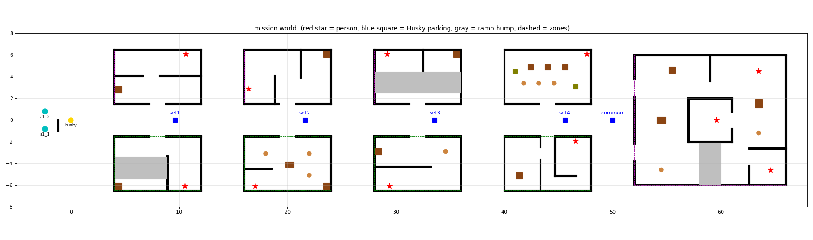

# 임무 v2 설계: 세트 4개 + 공동 건물, Husky 자율주행·A1 추종

작성 2026-11-12. 이전 구조(건물 1채, Husky 고정)는 `system_structure.md`. 이 문서는 바뀐 부분과 전체 흐름을 적는다.
코드: `code/ros2_hw_gz_src`, 빌드 작업 공간: `ws/` (src 는 code 로 가는 링크). 원본(fix19)은 `~/ros2_hw_gz` 에 그대로 있다.

## 1. 월드



- 도로 = x 축(폭 3 m). 세트 1·2·3·4 는 도로 양옆 8×5 m 건물 한 쌍(남 = a1_1, 북 = a1_2), 문은 도로 쪽 가운데 1.6 m.
  도로 끝(x 52~66)에 공동 건물 14×12 m (서쪽 문 2개).
- 세트 4 (x 40~48, 2026-11-19 추가) 는 아래 배치 규칙을 **일부러 어기는 시험 장면**이다. 장애물을 쉽게 바꾸지 않고 보행·Nav·SLAM 의 강건성을 보려고 넣었다.
  남쪽(a1_1)은 폭 1.2 m L 자 복도(90° 꺾임 2 번)와 1.0 m 문 → 안쪽 방 사람, 북쪽(a1_2)은 기둥·상자가 1.0~1.2 m 틈으로 늘어선 방 + 라이다 평면 아래 낮은 잔해(0.12 m) 2 개.
  공동 건물은 안의 배치 그대로 12 m 동쪽으로 옮겼다.
- 출발: Husky (0, 0), A1 은 뒤 (−2.4, ∓0.8). a1_1 앞 1.2 m 에 작은 벽(1 m, 높이 0.6 m).
- 건물마다 방·칸막이, 상자·기둥(0.7 m 이상), 사람 1명(공동 건물 3명, 합 11명). 세트 1 남쪽·세트 3 북쪽·공동 건물에는
  경사로(8° 오르내림 둔덕, 꼭대기 0.14 m)가 있다.
- 배치 규칙 (시험하며 정함, `make_world.py` 머리에도 적음):
  - 지나다니는 통로·방은 폭 2.0 m 이상, 1.6 m 는 곧장 지나는 문·개구부에만. 지나자마자 90° 넘게 꺾어야 하는 개구부(벽 끝을 돌아 들어가는 방 입구)는
    2.4 m 이상 (1.6 m 였던 세 곳에서 추종 실패·갇힘이 되풀이됨).
    비용지도에서 벽이 양쪽 0.3 m 씩 두꺼워져 1.7 m 통로가 1.0 m 로 줄고,
    그 폭에서는 DWB 추종이 제자리에서 돌다 실패했다.
  - 장애물·사람은 벽에 붙이거나 둘레 1.3 m 이상 비운다 (사람과 뒷벽 사이 0.9 m 틈에 들어가 끼었음).
  - 경사로는 벽에서 벽까지 방 폭 전체를 덮는다 (옆 가장자리·난간 없음). 원본 맵은 넘어짐 4번이 전부 경사로 옆 가장자리였고,
    난간(0.5 m)을 단 폭 1.9 m 경사로는 난간 끝에 끼어 제자리걸음 → 다리 odom 만 전진해 SLAM 위치가 2 m 넘게 흘렀다.
  - 장애물은 0.5 m 이상만 둔다 (라이다 평면 0.30 m 아래는 2D 라이다가 못 봄).
- **배치의 원본은 `disaster_sim/scripts/make_world.py` 하나**다. 실행하면 `worlds/mission.world` 와
  `config/mission.yaml`(스폰, 추종 자리, 세트별 주차점·구역 사각형·사람 수, 평가용 사람 정답)을 같이 쓴다.
  노드는 좌표를 코드에 두지 않고 이 yaml 만 읽는다. 원본 맵은 `world:=disaster.world` 로 띄울 수 있다(월드만).

## 2. 임무 흐름

```
IDLE --start--> TRANSIT k --Husky 도착 + A1 둘 다 자리 도착--> EXPLORE k --둘 다 탐색 시작 위치 복귀--> TRANSIT k+1 ... --> DONE
                                                              └--explore_timeout--> REGROUP k (Husky 가 부름) --┘
```

| 단계 | Husky | A1 |
| --- | --- | --- |
| TRANSIT | 주차점으로 주행. A1 이 2.5 m 넘게 처지면 서서 기다림 | Husky 뒤 자기 자리(뒤 1.6 m, 좌우 0.8 m)를 따라감, 라이다로 회피. Husky 위치는 통신으로 받은 자세를 라이다로 본 Husky 로 고쳐 씀 |
| EXPLORE | 정차, 사람 보고 집계 | 자기 구역 프런티어 탐색 → 프런티어 0개가 30 s 면 스스로 탐색 시작 위치로 복귀 |
| REGROUP | 정차 | 남은 탐색을 접고 탐색 시작 위치로 복귀 |

- 세트 완료 = A1 두 대 모두 탐색 시작 위치 복귀(`/<ns>/set_done`). 찾은 사람이 설정 수보다 적으면 '미발견 n'으로 남기고 진행한다
  (지도가 끝났으면 더 볼 곳이 없으므로 기다리지 않는다).
- 통신 0: A1 은 지나온 길을 되짚어 이번 세트 탐색 시작 위치로 돌아와 선다(이동 단계였다면 그 자리에 선다), Husky 는 정지.
  통신 1: 하던 단계를 이어 간다. 끊긴 동안 발견한 사람은 모았다가 복구되면 보고한다.
- 좌표 기준은 Husky 다. A1 의 SLAM 지도는 도로 40 m 를 가며 1 m 까지 어긋났으므로(odom 눈금 1.3 % 오차 + 정합 흐름),
  이동이 끝나 탐색으로 넘어갈 때마다 A1 이 '라이다로 본 Husky 와 통신으로 받은 Husky 자세의 차'만큼 자기 지도 정렬을 옮긴다
  (`/<ns>/pose_fix`). Husky 자세 추정(바퀴 속도 × IMU yaw)은 40 m 에 0.15 m 안이었다.
- 공동 건물처럼 출발 자리가 문에서 멀면(4 m) 문 너머 지도가 듬성듬성해 목표가 안 나온다. 그때는 프런티어에 가장 가까운
  닿을 수 있는 칸으로 먼저 다가간다(접근 목표, 로봇이 구역 밖일 때만).
- 공동 건물은 두 A1 의 구역이 같은 사각형이다. 합친 지도에서 프런티어를 뽑으므로 한쪽이 본 곳은 다른 쪽 후보에서 빠지고,
  목표 배정은 두 목표가 3 m 보다 가까우면 벌점을 줘 서로 떨어진 프런티어를 고른다.

## 3. 노드

| 노드 | 위치 | 역할 | 주요 입출력 |
| --- | --- | --- | --- |
| `husky_mission` | comm_relay | 사용자 명령(start/0/1), 단계 진행, 구역·홈 지정, 통신 하트비트, 사람 집계 | 입 `/husky/cmd` 출 `/mission/state`, `/husky/goal`, `/husky/go`, `/<ns>/comm_status`, `/<ns>/home_shared`, `/husky/survivors` |
| `husky_driver` | comm_relay | 목표점까지 주행 + 2D 라이다 회피, 위치 추정(바퀴 속도 × IMU yaw) | 입 `/husky/goal`, `/husky/go` 출 `/husky/cmd_vel`, `/husky/pose`, `/husky/driver_state` |
| `a1_follower` | comm_relay | TRANSIT 때 Husky 뒤 자리 추종 + 라이다 회피, 이동 끝에 Husky 기준 자세 보정 | 입 `/husky/pose`, `/<ns>/pose_shared`, `/<ns>/scan` 출 `/<ns>/cmd_vel_follow`, `/<ns>/slot_error`, `/<ns>/pose_fix` |
| `nav_executor` | comm_relay | EXPLORE·REGROUP 때 Nav2 계획·추종, 실패 처리, 완료 판정, 탐색 시작 위치 복귀 | 출 `/<ns>/set_done` |
| `return_relay` | comm_relay | 통신 끊김 → 지나온 길 되짚어 복귀 | 출 `/<ns>/cmd_vel_return`, `/<ns>/comm_mode` |
| `cmd_vel_arbiter` | comm_relay | 조종 > 사람 발견 정지 > 통신 복귀 > Nav2 > 추종 | 출 `/<ns>/cmd_vel` |
| `frontier_comm_filter` | comm_relay | 지금 구역 밖·실패 목표 주변 프런티어 제거 | |
| `survivor_detector` | comm_relay | 카메라 사람 인식 → 위치(상자 높이로 본 거리와 맞는 라이다 점) → Husky 보고 | 출 `/husky/survivor_report` |
| `clock_throttle` | comm_relay | `/clock`(1 kHz) → `/clock_slow`(50 Hz), 파이썬 노드용 | |
| `frontier_detector`, `goal_assigner`, `nav_goal_bridge` | a1_exploration | 프런티어 추출, 두 로봇 목표 배정, 지도 병합·좌표 변환 | |

- 조향은 `drive_logic.Steer` 하나를 Husky 와 A1 추종이 같이 쓴다: 목표 방위에서 가까운 순으로 후보 방향을 훑어,
  몸 폭 띠 안에 라이다 점이 없는 첫 방향으로 간다. 트인 방향이 없으면 선다.
- 없앤 노드: `husky_comm_switch`, `husky_zone_planner`, `husky_survivor_board`(→ `husky_mission` 하나로), `los_checker`,
  `zones.py`, `zone_assign.py`, `comm_zones.yaml`(→ `/mission/state` 의 구역 사각형).
- Husky 모델: Clearpath A200 공식 메시·치수·질량(`clearpath_platform_description`), Gazebo DiffDrive(바퀴 4개),
  센서는 2D 라이다(앞 270°, 12 m)와 IMU. `disaster_sim/models/husky`.

## 4. 실행

```
cd <저장소>/ws && source install/setup.bash
bash src/comm_relay/tools/run_mission.sh            # 전체를 순서대로 띄우고 start 까지 보냄, 결과는 <저장소>/results/
GUI=1 START=0 bash src/comm_relay/tools/run_mission.sh    # 화면 켜고, start 는 직접
ros2 topic pub --once /husky/cmd std_msgs/msg/String "{data: start}"      # 0 / 1 도 같은 토픽
```
Husky 를 여는 노드를 터미널에서 직접 쓰려면 `mission.launch.py husky:=false` 로 띄우고
`ros2 run comm_relay husky_mission` 을 실행한 터미널에 `start`, `0`, `1` 을 입력한다 (launch 순서는 `mission.launch.py` 머리말).
부분 시험: `SETS=1 bash run_mission.sh 4` = 공동 건물만 (세트 번호 0~4, 3 = 세트 4. 로봇을 그 세트 직전 위치에 놓고 시작).
`BAG=1` 이면 SLAM 오프라인 재생용 bag 도 남긴다. 발표용 2D 배속 영상: `python3 tools/mission_anim.py <결과 폴더> --speed=20`.

## 5. 시험 결과 (2026-11-12~20, Gazebo Sim headless, RTF 약 0.3)

기록은 `results/<시각>_setK/` (summary.txt, timeline.csv, motion.csv, stuck.txt, 노드 로그). 위치·사람 정답은 Gazebo 정답 자세로 평가만 한다.
판정(`mission_watch.py`): PASS = 끝까지 감 + 넘어짐 0 + 탐색 시간 한도(REGROUP) 0 + 맡은 세트의 사람을 전부 정답 1.0 m 안으로 보고 + 홈 실패 0 (2026-11-19 추가. 그 전에는 복귀를 8 번 실패하고 그 자리에 선 A1 도 '복귀'로 셌다).

### 강건성 실험 (2026-11-19~20): 장애물은 그대로 두고 Nav·보행·SLAM 을 고침
- 방법: 한 묶음에 동작 변경 하나, 판정 기준은 실행 전에 `results/<실험>_기준.txt` 에 적음, 바꾼 동작이 실제로 작동한 횟수를 먼저 셈.
  벤치마크 = 어려운 장면 세 곳 부분 시험 × 2 회 (세트 2 남쪽 홀, 세트 4, 공동 건물), `SETS=1 BAG=1`.
- 진단 도구 (동작 변경 없음): `motion.csv` (2 Hz, 로봇별 명령·출처·정답·odom), `stuck_report.py` (추종 중 정답 5 s 동안 0.1 m 미만 = 멈춤,
  원인을 보행 / Nav 로 나눔), `slam_replay.py` (bag 으로 slam_toolbox 파라미터 비교), `gait_sweep.sh` 에 옆걸음·제자리 회전.
- 기준선 진단: 멈춘 시간의 99 % 가 Nav 쪽 (DWB 0 명령·진동·제자리 회전), 보행이 명령을 못 따른 것은 거의 없음.

| 묶음 | 바꾼 것 | 벤치마크 결과 (6 회) | 판정 |
| --- | --- | --- | --- |
| 기준선 | (DWB, NavFn) | PASS 5/6, 홈 실패 1, 멈춤 합 397 s, Failed to make progress 24, 탐색 합 2470 s | |
| N2 | DWB 후진 허용 (-0.1 m/s) + 진행 검사 0.2 m | 5 회 중 PASS 1, 홈 실패 3, 멈춤이 모든 장면에서 늘어남 (앞뒤 진동, odom 흐름 최대 4.19 m) | 기각 |
| **N1** | **국소 컨트롤러 DWB → MPPI** (앞 0~0.2 m/s, 후진 없음) | **6/6 PASS, 홈 실패 0, 멈춤 합 56 s, Failed to make progress 3, 탐색 합 2061 s** | **채택** |
| N3 | 전역 플래너 NavFn → Smac 2D | 5 회 중 PASS 4 (세트 4 북쪽 사람 놓침), 탐색 시간 이득 없음 (-0.6 %) | 기각 |
| G2 | MPPI 옆걸음 허용 (Omni, vy 0.1 m/s) | 6/6 PASS, 멈춤 0 s, 탐색 합 2058 s | 채택했다가 되돌림 (아래) |
| S1 | slam_toolbox 정합 창·최소 이동 거리 | 같은 bag·같은 설정 재생 8 번의 최대 오차가 0.97~4.03 m 로 재현 안 됨 → 비교 불가 | 중단 |

- G2 는 전체 임무에서 문제가 드러났다: 추종 중 몸 방향이 이동 방향과 20° 넘게 어긋난 비율이 45~50 % (N1 1~2 %). 이동의 절반을 비스듬히 걸어
  카메라가 가는 길을 안 보고, 전체 임무 1 회에서 세트 1 북쪽 사람을 0.63 m 까지 가고도 시야 밖이라 놓쳤다. 멈춤 감소 이득(56 → 0 s)은
  N3(DiffDrive) 에서도 0 s 여서 실행마다의 흔들림 범위로 보고 되돌렸다.
- MPPI 의 비용: 계산이 무거워 controller 주기(10 Hz, 벽시계) 놓침 경고가 실행당 수천 번 (DWB 0). 남은 한계 참고.

### 최종 설정 (기준선 + N1) 전체 임무 — 세트 5 곳, 사람 11 명
| 실행 | 결과 | 사람 | 홈 실패 / 넘어짐 | 전체 시뮬 시간 | 탐색 (세트 1 / 2 / 3 / 4 / 공동) | 멈춤 | SLAM 최대 오차 (a1_1, a1_2) |
| --- | --- | --- | --- | --- | --- | --- | --- |
| `20261120_184028_set0_finaln1_1` | PASS | 11/11 | 0 / 0 | 1910 s | 228 / 405 / 400 / 348 / 324 s | 18 s | 0.72, 0.48 m |
| `20261120_203446_set0_finaln1_2` | FAIL | 10/11 | 0 / 0 | 1582 s | 169 / 262 / 221 / 304 / 397 s | 6 s | 0.25, 0.23 m |
| (G2) `20261120_134110_set0_final_1` | FAIL | 10/11 | 0 / 0 | 1738 s | 181 / 428 / 232 / 358 / 315 s | 0 s | 0.26, 0.32 m |
| (G2) `20261120_153450_set0_final_2` | PASS | 11/11 | 0 / 0 | 1548 s | 178 / 266 / 203 / 361 / 334 s | 0 s | 0.43, 0.43 m |

- MPPI 로 돌린 전체 임무 4 회: PASS 2, FAIL 2 (둘 다 사람 1 명만 놓침). 네 번 모두 다섯 세트를 끝까지 갔고 홈 실패·넘어짐·시간 한도 초과 0,
  Failed to make progress 0. 기준선 코드의 마지막 전체 임무(`20261118_220301_set0`, 세트 4 추가 전 네 곳)는 홈 실패 3 으로 FAIL, SLAM 최대 0.83 / 0.86 m.
- N1 2 회의 놓친 사람: 세트 4 남쪽 L 자 복도 끝 안쪽 방. a1_1 이 1.0 m 문 근처에서 경로 추종 실패 2 번 → '같은 자리 2 번 → 폐경로로 닫고 물러남'
  → 그 뒤 안쪽 방 쪽 목표가 '폐경로 지남' 으로 버려져 프런티어 0 으로 탐색 끝 (사람까지 2.6 m, 복도 벽 너머). 이 사람은 다른 MPPI 실행 7 번에서는 모두 찾았다.
- N1 1 회의 보고 12 건 중 1 건은 세트 3 북쪽 사람의 중복 보고 (정답에서 1.5 m, 묶는 거리 1.0 m 밖).
- 2D 배속 영상: `results/20261120_184028_set0_finaln1_1/mission_x20.mp4` (`tools/mission_anim.py`, 20 배속, 96 s).
  세트 4 3D 장면 클립: `results/20261120_224610_set3_clip/set4_x8.mp4` (최종 설정, 세트 4 부분 시험 PASS, 8 배속, 39 s). WSL 소프트웨어 렌더링에서는 Gazebo GUI 가 ogre2 로 죽고
  Fortress 녹화 플러그인은 서비스로 못 켜서, GUI(ogre1)의 `/gui/screenshot` 을 시뮬 0.5 s 마다 불러 이었다.

### DWB 시절 마지막 PASS 전체 임무 (세트 3 + 공동 건물, `results/20261114_062151_set0`, 세트 1 에서 통신 0/1 조작) — PASS
| 단계 | 시뮬 시간 | 사람 (정답 1 m 안 / 설정) | 복귀 | SLAM 공유 자세 오차 평균 / 최대 (a1_1, a1_2) |
| --- | --- | --- | --- | --- |
| 이동 → 세트 1 | 57 s | | | |
| 탐색 세트 1 (통신 끊김 60 s 포함) | 265 s | 2/2 | 둘 다 | 0.52 / 0.97, 0.10 / 0.12 m |
| 이동 → 세트 2 | 49 s | | | |
| 탐색 세트 2 | 787 s | 2/2 | 둘 다 | 0.27 / 0.38, 0.13 / 0.19 m |
| 이동 → 세트 3 | 49 s | | | |
| 탐색 세트 3 | 260 s | 2/2 | 둘 다 | 0.20 / 0.30, 0.13 / 0.19 m |
| 이동 → 공동 건물 | 19 s | | | |
| 탐색 공동 건물 | 421 s | 3/3 | 둘 다 | 0.58 / 0.99, 0.15 / 0.28 m |
| 합 | 1907 s (실제 약 2 시간) | 9/9 | | |

- 넘어짐 0, 시간 한도 초과 0, 계획 실패 0 (NavFn 오류 0). 사람 보고는 정확히 9 건 (중복·오탐 없음).
- 통신 0 (144~194 s): 두 A1 모두 1.1 s 뒤 RETURNING 으로 지나온 길을 되짚고 Husky 는 정지. a1_1 은 50 s 뒤 '홈 도착, 여전히 단절' 로 HOLD
  (선 자리는 (7.65, -1.65) 로 탐색 시작 위치에서 0.85 m 떨어진 문 앞 — 되짚기가 odom 기준이라 odom 이 흐른 만큼 어긋남), a1_2 는 되짚는 중이었다.
  통신 1: STOPPING(1 s) → NORMAL, 탐색 재개.
- Husky 기준 자세 보정 (세트 도착 때): a1_1 은 세트 2 도착 때 **1.37 m**, 세트 3 도착 때 0.71 m, 공동 건물 0.25 m. a1_2 는 0.14 / 0.21 / 0.17 m.
  a1_1 의 SLAM 지도는 세트 1 탐색과 이동 중에 옆으로 1.3 m 까지 흘렀지만 (최대 오차 1.27 m, 세트 2 도착 직전), 라이다로 본 Husky 기준 추종이라
  실제 위치는 차선 안이었고 (이동 중 |y| 0.72~0.82 m, a1_2 0.73~1.01 m), 도착 뒤 보정으로 세트 2 탐색 중 오차는 평균 0.27 m 였다.
- a1_1 은 추종 실패 7 번, 복귀 시도 5 번 (네 세트 모두 결국 도착). a1_2 는 추종 실패 3 번, 복귀 시도 6 번.
  세트 2 탐색 787 s 는 남쪽 홀(기둥 3·상자 2)에서 a1_1 이 남은 프런티어를 처리한 시간이다.
- 공동 건물 협업: a1_1 은 탐색 시간의 79 % 를 남쪽(y < 0), a1_2 는 90 % 를 북쪽에서 보냄. 1 m 칸으로 센 방문 칸 31 / 23 개, 겹친 칸 5 개.
- 가장 가까웠던 순간 (중심 거리, 1 Hz 기록): A1 끼리 **0.46 m** (공동 건물 북쪽 (47.9, 3.8) 근처에서 엇갈릴 때. 몸 길이 0.6 m 라 닿았을 수 있다 — 접촉은 따로 재지 않음),
  a1_1-Husky 1.49 m, a1_2-Husky 1.39 m.

### 그 전에 통과한 실행 (`results/20261113_035152_set0`, 통신 조작 없음) — PASS
| 단계 | 시뮬 시간 | 사람 (정답 1 m 안 / 설정) | 복귀 | SLAM 공유 자세 오차 평균 / 최대 (a1_1, a1_2) |
| --- | --- | --- | --- | --- |
| 이동 → 세트 1 | 60 s | | | |
| 탐색 세트 1 | 184 s | 2/2 | 둘 다 | 0.17 / 0.55, 0.12 / 0.18 m |
| 이동 → 세트 2 | 49 s | | | |
| 탐색 세트 2 | 240 s | 2/2 | 둘 다 | 0.11 / 0.17, 0.08 / 0.20 m |
| 이동 → 세트 3 | 49 s | | | |
| 탐색 세트 3 | 207 s | 2/2 | 둘 다 | 0.13 / 0.20, 0.43 / 0.78 m |
| 이동 → 공동 건물 | 19 s | | | |
| 탐색 공동 건물 | 566 s | 3/3 | 둘 다 | 0.13 / 0.24, 0.16 / 0.65 m |
| 합 | 1375 s (실제 약 80 분) | 9/9 | | |

- 넘어짐 0, 시간 한도 초과 0. 사람 보고는 11 건: 정답 9 명 + 공동 건물에서 위치가 어긋난 2 건 (세트 1~3 은 중복 없음).
- Husky 기준 자세 보정(세트 도착 때): a1_1 1 번 (0.14 m), a1_2 3 번 (0.20, 0.20, **0.86 m**). 세트 3 에서 a1_2 지도가 0.78 m 까지 흘렀고
  공동 건물 도착 때 0.86 m 를 고쳐 오차 평균이 0.16 m 로 돌아왔다. 이 보정이 없던 실행(`20261112_190640_set0`)에서는 a1_2 가 1 m 어긋난 채
  이동하다 세트 3 건물 문으로 들어가 공동 건물 탐색이 실패했다.
- 가장 가까웠던 순간 (중심 거리): a1_1-Husky 0.61 m (공동 건물로 들어가려 정차한 Husky 옆을 지날 때, 몸 사이 약 0.1 m),
  A1 끼리 0.76 m (공동 건물 가운데 방에 둘이 같이 있을 때). 접촉은 기록에 없지만 여유는 작다.
- 공동 건물 협업: a1_1 은 탐색 시간의 70 % 를 남쪽(y < 0), a1_2 는 59 % 를 북쪽에서 보냄. 1 m 칸으로 센 방문 칸 31 / 23 개, 겹친 칸 4 개.
  (공동 건물만 돌린 `20261112_182933_set3`: 88 % / 73 %, 27 / 28 칸, 겹침 3 칸.)
- 이동 중 추종: A1 두 대가 Husky 약 1.9 m 뒤에서 좌우 ±0.65 m 차선 유지 (자리 설정은 ±0.8 m, 라이다로 본 Husky 중심 추정이 0.15 m 쯤 안쪽으로 치우침).
  출발점의 작은 벽은 a1_1 이 바깥쪽으로 돌아감 (모든 실행).

### 재현성: 같은 임무를 통신 0/1 을 넣어 다시 돌린 실행들 (2026-11-13)
세트 1 탐색 80 s 시점에 통신 0, 60 s 뒤 1. 실행마다 직전 실행에서 찾은 문제를 고쳤으므로 코드가 조금씩 다르다.

| 실행 | 바뀐 것 | 결과 |
| --- | --- | --- |
| `20261113_091042_set0` | (통과 실행과 같은 코드) | 세트 1 에서 멈춤: a1_1 은 안쪽 방 목표 추종 1 번 실패 뒤 90 s 규칙으로 그 방을 못 보고 복귀(사람 1/2), a1_2 는 복귀 계획 3 번 실패(NavFn A* 오류) 뒤 건물 안에 남음 -> Husky 가 기다리며 정지 |
| `20261113_100158_set0` | NavFn 다익스트라, 실패 목표 60 s 뒤 재시도 | 세트 1·2 통과(사람 4/4), 계획 실패 0 건. 세트 2 에서 a1_2 가 벽 끝을 돌아야 하는 1.6 m 입구를 못 나와 복귀 8 번 실패 -> 정지 (사용자 중단) |
| `20261113_113239_set0` | 꺾이는 입구 2.4 m 로 넓힘 | 세트 1 통과(사람 2/2). 세트 2 남쪽에서 안 지워지는 프런티어를 되풀이 방문해 700 s 넘게 안 끝남 (중단) |
| `20261113_123720_set0` | 같은 자리 방문 3 번 제한 | **끝까지 감** (2007 s, 한도 초과 0, 넘어짐 0, 중복 보고 0. 공동 건물에서 a1_1 홈 실패 — 전에는 '네 세트 모두 둘 다 복귀'로 적었으나 2026-11-19 로그 재확인). 사람 7/9: 세트 2 북쪽 방은 a1_2 가 입구 추종 3 번 실패로 포기, 공동 건물은 a1_2 가 타이머 버그로 탐색 없이 복귀해 가운데 방을 못 봄 |

- 통신 0/1: 네 실행 모두 0 에서 두 A1 이 1.1 s 뒤 RETURNING 으로 되짚고 Husky 는 정지, 1 에서 STOPPING -> NORMAL 로 탐색 재개. `20261113_100158_set0` 에서는
  60 s 동안 a1_1 이 (6.1, -2.4) -> (7.5, -0.8), a1_2 가 (10.9, 5.3) -> (7.9, 1.3) 로 탐색 시작 위치 근처까지 돌아왔다.
- `20261113_123720_set0` 뒤에 고친 것: '목표 없음 90 s' 타이머를 세트마다 초기화. 공동 건물만 돌린 확인 실행 `20261113_181643_set3` 은 PASS
  (탐색 490 s, 사람 3/3 중복 없음, 둘 다 복귀, 넘어짐 0, SLAM 오차 0.25 m 이하).
  그 사이 `20261113_172454_set3` 은 타이머에 '거부된 목표 시도'까지 넣었다가 복귀로 못 넘어가 중단했고, 그 부분은 뺐다.
- 그 수정까지 넣고 다시 돌린 전체 임무 `20261114_011715_set0` (통신 0/1 포함) — 당시 PASS, 홈 실패를 세는 지금 기준으로는 **FAIL** (공동 건물에서 a1_1 이 복귀 8 번 실패 뒤 그 자리에 섬, 2026-11-19 로그 재확인): 1895 s, 사람 9/9, 한도 초과 0, 넘어짐 0.
  | 단계 | 시뮬 시간 | 사람 | SLAM 오차 평균 / 최대 (a1_1, a1_2) |
  | --- | --- | --- | --- |
  | 이동 → 세트 1 / 탐색 (통신 끊김 60 s 포함) | 54 / 309 s | 2/2 | 0.53 / 0.86, 0.14 / 0.18 m |
  | 이동 → 세트 2 / 탐색 | 49 / 522 s | 2/2 | 0.14 / 0.24, 0.15 / 0.24 m |
  | 이동 → 세트 3 / 탐색 | 49 / 232 s | 2/2 | 0.17 / 0.23, 0.14 / 0.27 m |
  | 이동 → 공동 건물 / 탐색 | 19 / 660 s | 3/3 | 0.35 / 0.65, 0.17 / 0.29 m |
  - 통신 0 (138~189 s): 둘 다 RETURNING, a1_1 (9.8, -2.7) -> (8.3, -0.4), a1_2 (6.2, 5.0) -> (9.9, 2.6), Husky 정지. 1: 재개.
  - 사람 보고 11 건 = 정답 9 + 추가 2 (세트 2 남쪽 점수 0.52, 세트 3 북쪽 점수 0.56: 둘 다 인식 점수가 낮은 것).
  - a1_1 이 약했다: 추종 실패 14, 계획 실패 7 (NavFn 오류 메시지는 1 건, 나머지는 길 없음), 복귀 시도 6 번 (전부 결국 도착). a1_2 는 추종 실패 5, 계획 실패 0.
  - 공동 건물 분담은 이번에는 치우쳤다: 방문 칸 a1_1 12 / a1_2 32, 겹침 2. a1_1 은 북쪽, a1_2 는 남쪽과 가운데를 봤다.
  - 가장 가까웠던 순간 (10 s 표본): a1_1-Husky 0.71 m (공동 건물로 들어가려 정차한 Husky 옆을 지날 때), a1_2-Husky 1.01 m, A1 끼리 1.29 m.
  - 세트 1 도착 때 a1_1 의 Husky 기준 자세 보정이 x 로 -0.47 m 였는데 틀린 보정이었다 (그 뒤 a1_1 오차 평균 0.53 m, 세트 2 도착 때 +0.53 m 로 되돌려짐).
    Husky 중심을 '보이는 점 평균에서 시선 방향 0.4 m' 로 어림한 탓 -> Husky 방향에 맞춘 상자 맞춤(`drive_logic.box_center`)으로 바꿈.
    세트 1 도착까지만 돌린 확인(`20261114_*_set0_transit_check`): 잘못된 보정 없음 (a1_2 만 0.11 m), 그 뒤 오차 0.02~0.24 m, 이동 중 차선이 설정값 ±0.8 m 와 일치 (전에는 ±0.65 m).
- 상자 맞춤까지 넣은 코드의 전체 임무가 'DWB 시절 마지막 PASS' 절의 `20261114_062151_set0` 이다.
- 정리: 첫 PASS 부터 세어 전체 임무를 7 번 돌려 끝까지 간 것이 4 번, 그중 PASS (홈 실패 0 포함) 는 2 번
  (`20261113_035152_set0`, `20261114_062151_set0`)이다. 멈추거나 놓친 원인은 그때마다 찾아 고쳤다.
  그 뒤 코드 정리(쓰이지 않던 Nav2 복귀 경로 삭제 등)를 넣고 돌린 `20261118_220301_set0` 은 사람 9/9 였지만 홈 실패 3
  (세트 2 남쪽 홀 a1_1, 공동 건물 가운데 방 a1_1·a1_2) 로 FAIL.

### A1 보행 (`tools/gait_sweep.sh`, 평지 8 s 씩, 정답 위치 기준)
| 명령 vx m/s | 0.1 | 0.2 | 0.3 | 0.4 | 0.5 |
| --- | --- | --- | --- | --- | --- |
| 실제 / 명령 | 99 % | 95 % | 107 % | 108 % | 107 % |
| 최대 기울기 | 2.3° | 2.3° | 3.7° | 4.6° | 5.5° |

- 걸으며 돌기 (0.25 m/s, ±0.3 rad/s): 이동 거리는 예상 호의 현 길이와 같고(1.56·1.53 m, 예상 1.55 m) 회전은 명령의 107~112 %, 좌우 대칭, 기울기 4° 이하.
- 2026-11-19 다시 잰 것 (`results/20261119_035852_gait_base2`): 아주 느린 전진 0.05 m/s 는 명령의 81 %, 0.1~0.4 m/s 는 98~108 %.
  옆걸음 vy ±0.1 / ±0.2 m/s 는 105~108 %, 기울기 2° 이하. 제자리 회전 ±0.3 / ±0.5 rad/s 는 107~109 %, 이동 0.05 m 이하.
  (이 측정의 0.5 m/s 전진은 기울기 37° 로 무효 — 12 m 넘게 곧장 간 끝이라 앞이 막혔던 것으로 보이나 확인 안 함.)
- 이 값으로 추종 최대 0.35 m/s, Husky 0.25 m/s 로 정했다. Nav2 탐색 속도는 0.2 m/s 그대로 (DWB·MPPI 모두, 올린 값은 시험 안 함).
  옆걸음은 보행으로는 잘 되지만, 컨트롤러에 허용하면 몸이 비스듬히 걸어 카메라가 길을 안 봐서 쓰지 않는다 (5 절 G2).
- `/odom` 이동 거리가 정답보다 1.3 % 짧아 `odom_scaler` 1.11 → 1.125 (보정 뒤 다시 재지는 않았다).
- 경사 위 보행은 따로 재지 않았다. 8° 둔덕은 임무 실행에서 넘어짐 없이 여러 번 넘었다.

### 시험하며 찾은 원인과 조치
| 증상 | 원인 | 조치 |
| --- | --- | --- |
| 추종 중 a1_2 가 11° 비스듬히 감 | 공유 좌표 정렬이 스폰 yaw 를 믿음 (기립 때 몸이 10° 돎) | 정렬 회전 0 (map 은 IMU ENU 로 이미 월드 방향) |
| 건물 안 탐색 후보가 없음 | 프런티어 상위 15 개를 도로 쪽이 차지 | frontier_detector 가 구역 안에서만 찾음 |
| 지도 번짐, 위치 2.3 m 어긋남 | 움직이는 Husky·상대 A1 이 SLAM 지도에 자취로 남음 | scan_ready_relay 가 다른 로봇에 맞은 빔을 지움 |
| 복귀 계획 실패 (도로에 위험 줄) | 지형 층이 앞서가는 Husky 뒷면을 단차 위험으로 찍음 | 지형 처리는 탐색 단계에만 + 다른 로봇 둘레 가림 |
| 좁은 방에서 위치 2.3 m 튐 | slam_toolbox 루프 클로징 (탐색 창 8 m) 으로 추정 | do_loop_closing false (효과는 따로 못 가림) |
| 남은 목표 전부 '폐경로' 거부로 멈춤 | 닫힌 자리 반경 0.8 m 가 문 하나를 통째로 막음 | 반경 0.4 m + 목표 없이 90 s 면 완료 처리 |
| 지나온 길 역추종(복귀 예비) 실패 | 뒤쪽 경로를 돌지 않고 추종 | 먼저 제자리 회전 |
| 난간·통로·사람 옆에 끼임, 제자리걸음 중 SLAM 2 m 흐름 | 폭 1.7 m 통로, 난간 끝, 사람과 벽 사이 0.9 m 틈 | 배치 규칙 (1 절) |
| 공동 건물에서 목표 0 | 문에서 4 m 떨어진 출발 자리: 문 너머 지도가 줄무늬 | 구역 밖일 때 프런티어 쪽 접근 목표 |
| 사람 모델 발판에 걸려 복귀 실패 | 목표 칸이 장애물에서 0.15 m 만 떨어져도 허용 | 목표 칸은 장애물에서 0.4 m 이상 |
| 40 m 뒤 a1_2 가 옆 건물 문으로 들어감 | SLAM 지도가 1 m 흐름 (odom 눈금 1.3 % + 정합 흐름) | 라이다로 본 Husky 기준 추종 + 세트마다 Husky 기준 정렬 보정 + odom_scaler |
| a1_1 이 출발 안 함 | Husky 찾기가 앞의 작은 벽을 Husky 로 잡음 | 받은 Husky 자세에서 0.7 m 넘게 벗어난 묶음은 버림 |
| 사람 보고 14 건 / 일치 7 명 | 위치를 '그 방향 가장 가까운 라이다 점'으로 잡음, 4 m 밖은 버림 | 상자 높이로 본 거리와 맞는 라이다 점, 범위 7 m |
| 복귀 계획이 0 점 경로로 실패, 건물 안에 남음 | NavFn A* 모드의 'Failed to create a plan from potential' 오류 | 다익스트라 모드 (그 뒤 실행들에서 이 오류 0~1 건) |
| 추종 한 번 실패로 방 하나를 못 보고 세트 종료 | 실패 목표 제외 120 s > '목표 없음' 90 s | 제외 60 s 뒤 재시도, 같은 곳 실패는 세트당 3 번까지 |
| 방에 들어갔다 못 나옴 | 벽 끝을 돌아야 하는 1.6 m 입구 | 그런 입구는 2.4 m 이상 (배치 규칙) |
| 세트가 700 s 넘게 안 끝남 | 가도 안 지워지는 프런티어를 제외가 풀릴 때마다 다시 방문 | 같은 자리 도착 3 번이면 그 세트에서는 그만 |
| 새 세트에서 첫 계획 실패 직후 탐색 없이 복귀 | '목표 없음' 타이머가 지난 세트 기준 | 세트마다 초기화 (거부된 시도는 세지 않음) |
| 세트 도착 때 자세 보정이 0.47 m 틀림 | Husky 중심을 시선 방향 0.4 m 로 어림 | Husky 방향에 맞춘 상자 맞춤 |
| RTF 낮음 | 파이썬 노드마다 /clock 1 kHz 수신 | /clock_slow 50 Hz 리맵, TF 발행 200 → 50 Hz |
| 추종 중 멈춤, 'Failed to make progress' 실행당 6~32 번 | 멈춘 시간의 99 % 가 Nav: DWB 가 0 명령·앞뒤 진동·제자리 회전 (보행 제자리걸음은 거의 없음) | 국소 컨트롤러 MPPI (N1). 벤치마크 멈춤 397 → 56 s, 홈 실패 1 → 0 |
| 후진 허용 뒤 홈 실패·멈춤 늘어남 | 후진이 앞뒤 진동과 odom 흐름(최대 4.19 m)을 키움 | 후진 없음 유지 (N2 기각) |
| 옆걸음 허용 뒤 사람을 0.63 m 까지 가고도 놓침 | MPPI Omni 가 이동의 45~50 % 를 몸이 20° 넘게 비스듬한 채 걷게 함 → 카메라가 길을 안 봄 | 옆걸음 끔 (G2 되돌림) |
| SLAM 파라미터 비교 불가 | 같은 bag·같은 설정 재생의 최대 오차가 0.97~4.03 m 로 흔들림 (원인 모름). 재생 도구가 slam_toolbox 를 남기는 버그도 있었음 | S1 중단. 도구는 프로세스 그룹째 끄도록 고침 |

### 남은 한계
- **MPPI 로 돌린 전체 임무(세트 5 곳)는 4 회 중 PASS 2 회다** (최종 설정 N1 은 2 회 중 1 회, G2 포함 4 회). FAIL 은 둘 다 사람 1 명을 놓친 것이고
  원인이 서로 다르다 (5 절). 몇 번에 한 번 통과하는지 말할 만큼 돌리지는 못했다. 같은 세트 탐색 시간도 실행마다 170~430 s 로 달라진다.
- 세트 4 남쪽처럼 폭 1.2 m 복도에서 추종이 두 번 실패하면 '폐경로' 복구가 그 자리를 닫는데, 복도가 안쪽 방으로 가는 유일한 길이면 그 방을 포기한다
  (N1 2 회에서 사람을 놓친 원인). 닫힌 길을 다시 여는 규칙은 없다.
- 사람 감지는 카메라 시야(좌우 약 ±52°) 안에 들어와야 한다. 몸이 다른 쪽을 보며 지나가거나 멈추면 가까이 가도 놓친다 (G2 실행은 0.63 m 에서 시야 밖이었음을 확인. N3 실행에서 1.62 m 까지 가고 놓친 것은 원인 확인 안 함).
  탐색은 지도(라이다)가 끝나면 끝나므로 '카메라로 본 곳'을 따로 세지 않는다.
- A1 의 SLAM 지도는 세트 하나를 도는 동안에도 흐를 수 있다 (DWB 시절 a1_1: 세트 1 에서 최대 0.97 m, 공동 건물 0.99 m. MPPI 전체 임무 4 회는 최대 0.23~0.72 m). 세트 도착 때마다 Husky 기준으로
  다시 맞추지만 세트 안에서 생긴 흐름은 그대로라, 그만큼 구역 사각형과 보고한 사람 위치가 어긋날 수 있다 (이 실행에서는 사람 9 명 모두 1 m 안).
- 통신이 끊겨 돌아와 서는 자리(HOLD)는 odom 기준이라 탐색 시작 위치에서 벗어날 수 있다 (마지막 실행 0.85 m).
- MPPI 로 바꾼 뒤 '진행 없음' 실패는 실행당 0~3 번으로 줄었지만, 좁은 문·복도에서 경로 추종 실패(status 6)는 남아 있다.
  같은 곳 3 번 실패하면 그 세트에서는 포기하므로 임무는 이어지지만 그 방의 사람은 놓친다.
- MPPI 는 계산이 무거워 controller 주기(10 Hz, 벽시계) 놓침 경고가 실행당 수천 번 나온다 (batch 1000 으로 줄인 값).
  결과는 이 PC (Intel Core Ultra 5 226V 8 코어, WSL2 7.5 GB, 시뮬 중 평균 부하 약 24) 에서 얻은 것이고, Gazebo 카메라는 GPU 대신
  소프트웨어 렌더러(swrast)로 그려진다. 벽시계에 묶인 부분(컨트롤러 주기)이 있어 더 빠른 PC 에서는 동작이 조금 다를 수 있다.
- SLAM 오프라인 재생(`slam_replay.py`)은 같은 bag·같은 설정으로도 결과가 재현되지 않아 (최대 오차 0.97~4.03 m) SLAM 파라미터 비교에 쓰지 못했다. 원인은 못 찾음.
- A1 이 무언가에 막혀 제자리걸음을 하면 다리 odom 이 계속 전진해 SLAM 위치가 흐른다 (원인 해결 못 함: 끼일 지형을 배치에서 빼고, 세트마다 Husky 기준으로 다시 맞춤).
- 복귀를 8 번 시도해도 못 돌아오면 그 자리에서 세트 완료로 보고한다. 그러면 다음 이동에서 Husky 가 그 A1 을 기다리며 선다.
  전체 임무 3 회에서 나왔고 자리는 공동 건물 가운데 방(4×4 m, 동쪽 입구 1.6 m, 가운데 사람)과 세트 2 남쪽 홀(기둥 사이 1.6 m)이다.
  둘 다 1 절 배치 규칙(꺾이는 입구 2.4 m, 통로 2.0 m, 둘레 1.3 m)에 못 미친다.
- 사람 위치가 어긋나거나 점수가 낮은 추가 보고가 섞일 수 있다 (MPPI 전체 임무 4 회 중 1 회에 중복 1 건, DWB 시절 PASS 두 실행은 2 건씩). 설정 사람 수와의 비교는 건수로 하므로 이런 보고가 섞이면 '모두 발견'이 일찍 찍힐 수 있다
  (세트 완료 자체는 두 A1 복귀로만 정한다).
- 프런티어가 0 이 아니라 '갈 수 있는 목표 없이 90 s' 로 끝나는 세트가 많다 (장애물 0.4 m 안이라 못 가는 프런티어가 남음) → 세트마다 최대 90 s 더 걸림.
- 세트 1~3 과 공동 건물의 배치는 원본 맵보다 쉽다 (통로 2 m 이상, 경사로 8° 둔덕·옆 가장자리 없음). 규칙을 어기는 곳은 세트 4 하나다.
  원본 `disaster.world` 에서 이 임무 구조를 돌려 보지는 않았다.
- 기동 때 Nav2 가 TF 를 못 받아 안 켜지는 일이 가끔 있다 (약 30 번 기동 중 5 번). `run_mission.sh` 가 한 번 다시 띄운다.
- 화면(GUI) 켠 실행, 사용자가 `husky_mission` 터미널에 직접 입력하는 경로는 돌려 보지 않았다 (명령은 `/husky/cmd` 토픽으로만 시험).
