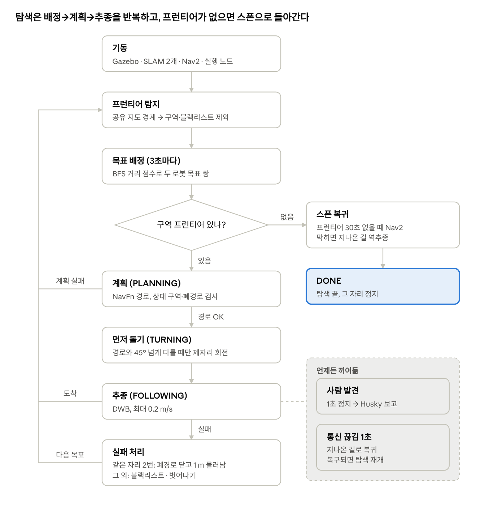
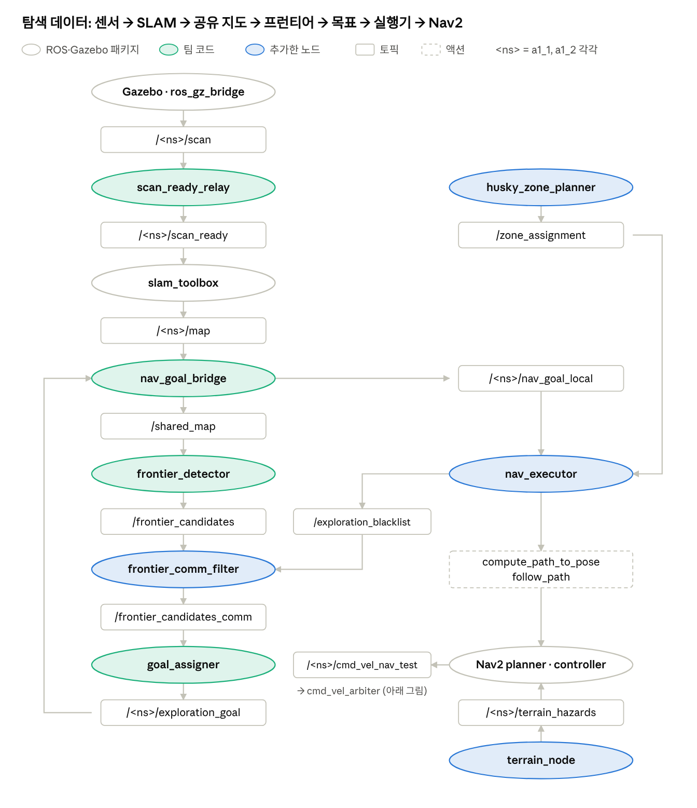
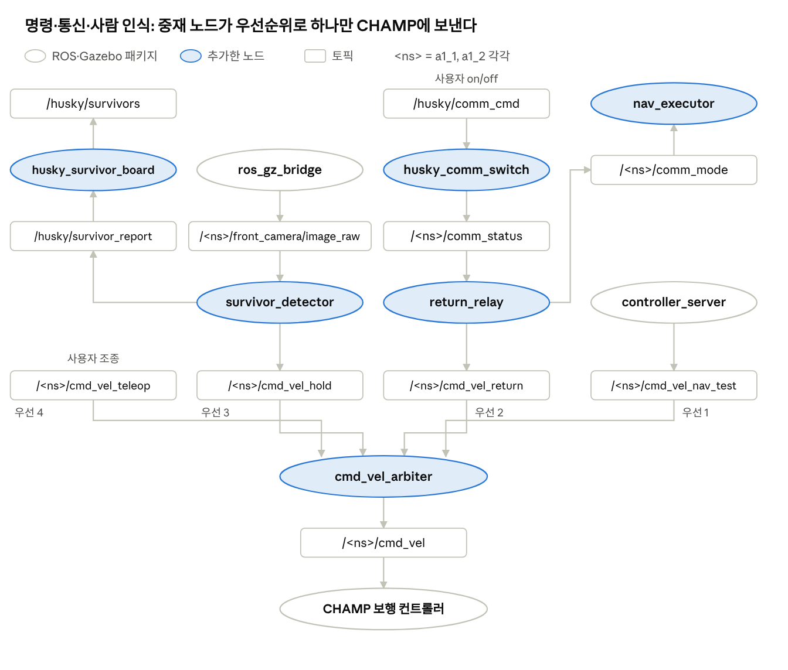

# A1 재난 탐색 시뮬레이션 시스템 구조

작성 2026-11-11 (fix15 기준, Claude 문서 https://claude.ai/artifact/AWcSAL8acEwV2X1oy1cgDL 의 사본).
**그 뒤 바뀐 것 (fix18·fix19)**: Nav2 전역 비용지도 팽창 반경 0.35 -> 0.70 m (fix18), 옮겨 보기가 0.3 m 뒤에도 로봇 칸 비용 >= 128 이면 트인 거리(최대 0.6 m)까지 더 감 (fix19). fix16(지형 위험 0.15 m 넓힘)·fix17(도착한 자리 끝까지 제외)은 되돌림. 최신 상태는 HANDOFF.md 4 절.

## 개요

두 대의 A1(남쪽 a1_1, 북쪽 a1_2)이 Husky를 경계로 자기 구역을 SLAM 지도로 탐색하고, 마네킹을 찾으면 1초 멈춘 뒤 Husky에 알리며, 구역을 다 보면 스폰으로 돌아온다. Husky 통신은 사용자가 켜고 끄고, 끊기면 지나온 길로 복귀한다.

- 환경: Gazebo Sim (Fortress) + ROS 2 Humble, WSL2. 서버는 소프트웨어 렌더링(GPU 라이다 거리값 버그 회피).
- 시간 기준: 모든 판정·한도는 시뮬 시간(`/clock`). RTF 0.2~0.3이라 시뮬 900초 = 실제 약 55분.
- 현재 단계: ① 0 명령 정지 진단 끝 → ③ 900초 맵 끝 판정 중, 좁은 곳 갇힘 처리(fix15) 검증 대기 → ② 구역 경계 처리 보류.
- 이 문서는 fix15 기준 코드를 읽고 정리했다. CHAMP 보행 내부와 EKF 설정은 이전 문서에 의존한다.

## 전체 동작 순서도

두 로봇이 각자 이 흐름을 돈다. 계획 실패·도착·실패 처리는 모두 프런티어 탐지로 돌아가고, 자기 구역에 갈 프런티어가 30초 없으면 스폰으로 복귀한다.

## 노드·토픽 통신 (rqt_graph 형식)

타원은 노드, 사각형은 토픽, 점선은 액션이다. 읽기 쉽게 두 그림으로 나누고, 로봇별 노드는 한 벌만 그렸다(실제로는 a1_1, a1_2 각각).

목표는 공유 지도 좌표로 나오고, `nav_goal_bridge`가 로봇 map 좌표(`nav_goal_local`)로 바꿔 실행기에 넘긴다. 실행기가 실패한 목표는 블랙리스트로 되돌아가 프런티어 후보에서 빠진다.

CHAMP에는 `cmd_vel_arbiter`만 쓴다. 통신이 끊기면 `return_relay`가 `comm_mode`로 실행기를 멈추고 복귀 명령을 낸다.

그림에 다 못 그린 연결:

| 토픽 | 발행 | 구독 |
| --- | --- | --- |
| `/<ns>/pose_shared` | nav_goal_bridge | goal_assigner |
| `/zone_assignment` | husky_zone_planner | goal_assigner, nav_executor |
| `/<ns>/exploration_blacklist` | nav_executor | goal_assigner (로봇 전용) |
| `/<ns>/odom`, `/<ns>/imu/data` | Gazebo·EKF | nav_executor, return_relay, terrain_node, scan_ready_relay |
| `/<ns>/local_costmap/costmap` | Nav2 controller | nav_executor (벗어나기·옮겨 보기) |
| `/<ns>/return_path` | return_relay | nav_executor |
| `/<ns>/scan` | Gazebo | survivor_detector, return_relay, Nav2 국소 비용지도 |
| `/<ns>/terrain_free` | terrain_node | Nav2 비용지도(clearing) |
| `/<ns>/comm_status` | husky_comm_switch | survivor_detector (보고 대기열) |
| `/<ns>/nav_executor/state` | nav_executor | return_relay, 모니터 |

## 섹션별 상세

각 모듈을 역할, 원리(모델·알고리즘), 이 프로젝트의 설정값 순서로 적었다.

### 1. 시뮬레이션·로봇·센서

- 역할: 건물, Husky(정지), 마네킹 3명(`person_standing`, `_0`, `_1`), 남쪽 경사로 2장(10°)을 만든다.
- 보행: CHAMP 계열 컨트롤러가 `cmd_vel`을 받아 발 궁적을 만든다. ign_ros2_control로 관절을 움직인다. 최대 0.2 m/s.
- 센서: 평면 라이다(`/<ns>/scan`), 전방 RGB 카메라 2 Hz(사람 인식), 지형 깊이 카메라 5 Hz, IMU.
- odom: EKF(`state_estimation`). TF의 roll/pitch는 0 고정이라 경사는 IMU로 따로 본다.

### 2. SLAM — slam_toolbox (로봇별)

- 원리: 스캔 매칭으로 자세를 구하고, 포즈 그래프를 Ceres(레벤버그-마쿼트)로 최적화하는 그래프 SLAM. 루프 클로징 켬.
- 설정: 비동기 매핑, 해상도 0.05 m, 지도 갱신 5초, 스캔 처리 이동 0.2 m. Humble은 회전만으로는 지도가 안 늘어난다(실험으로 확인).
- 입력 전처리: `scan_ready_relay`가 몸이 기울 때 스캔을 버려 경사로의 가짜 벽을 막는다.

### 3. 지도 공유 — nav_goal_bridge (shared_map_merger 계열)

- 원리: 두 지도를 알려진 스폰 자세로 옮겨 합친다. a1_1 (0, −1.1, −90°), a1_2 (0, 1.1, +90°). 지도끼리 맞추는 방식이 아니다.
- 출력: `/shared_map`(월드 정렬), 로봇 위치.

### 4. 프런티어 탐지 — frontier_detector

- 빈 칸(값 0~20) 중 4방향 이웃이 미탐색(−1)인 칸이 프런티어.
- 8방향 연결로 묶고 5칸 미만은 버린다. 큰 묶음부터 `/frontier_candidates`로 낸다.
- `frontier_comm_filter`가 통신 단절 구역(+여유)과 블랙리스트 주변을 빼 `/frontier_candidates_comm`으로 넘긴다.

### 5. 목표 배정 — goal_assigner (3초마다)

- 걸을 수 있는 칸: 값 0~20, 값 50 이상 장애물에서 여유 거리 안은 제외.
- 경로 거리: 로봇 칸에서 4방향 BFS 걸음 수 × 0.05 m (맨해튼형 거리).
- 후보: 프런티어 0.65 m 안 안전한 칸 중 `점수 = 경로거리 + 1.2 × 프런티어까지 거리`가 최소인 칸.
- 두 로봇 배정: 서로 다른 프런티어이고 0.75 m 이상 떨어진 쌍 중 점수 합 최소(완전 탐색). 자기 구역 밖 후보는 버린다.
- 출력: 로봇별 목표(`/<ns>/goal_pose`, 공유 지도 좌표는 `nav_goal_bridge`가 로봇 map 좌표로 바꿈).

### 6. 실행기 — nav_executor (로봇별 상태기계)

- 상태: IDLE → PLANNING → (TURNING) → FOLLOWING → 도착/실패 → IDLE. 그 외 ESCAPING, RETURNING, PAUSED, FALLEN, DONE.
- 먼저 돌기: 경로 방향이 45° 넘게 다르면 제자리 회전(경사 6° 넘으면 생략).
- 목표 유지: 지금 목표 1 m 안에 프런티어가 남아 있으면 새 목표 보류(최소 8초).
- 실패 처리: 로봇 전용 블랙리스트, 벗어나기(치명 칸 반대쪽), 옮겨 보기(가장 트인 쪽), 0 명령 감시(8초), 기울기 가드(25°, 1초), 같은 곳 반복 실패 차단.
- 폐경로(fix14/15): 같은 자리(0.5 m) 추종 실패 2번이면 그 자리를 닫고 지나온 길 1 m 물러남. 닫힌 자리 0.8 m를 지나는 경로의 목표는 안 감.
- 완료·홈: 갈 수 있는 자기 구역 프런티어 0개가 30초 → 스폰으로 Nav2. 계획이 2번 넘게 실패하면 지나온 길을 거꾸로 추종. 도착하면 DONE.

### 7. Nav2 — 계획과 추종

- 전역 계획 NavFn: 비용지도 위 다익스트라/A*(A* 켬), tolerance 0.25 m, 미탐색 칸 통과 허용.
- 전역 비용지도: SLAM 지도(static) + 지형 층 + 팽창 0.35 m. footprint 사각형 0.60 × 0.32 m.
- 국소 비용지도: 3 × 3 m 롤링 창, 5 Hz, 라이다 장애물 층 + 지형 + 팽창.
- 추종 DWB: 속도(vx, wz) 후보를 샘플링해 1초 궁적을 예측하고, 비용 항목 합이 가장 작은 것을 고른다. 항목: Oscillation, BaseObstacle, GoalAlign, PathAlign, PathDist, GoalDist(RotateToGoal은 fix10에서 벌).
- 제한: 최대 0.2 m/s, 0.5 rad/s. 선속도 < 0.03 이고 회전 < 0.05 인 궁적 무효(fix12). 도착 xy 0.20 m, 방향 무관. 10초에 0.3 m 못 가면 실패.

### 8. 지형 인식 — terrain_perception

- 깊이 카메라 점구름을 IMU roll/pitch로 보정해 기울기·단차가 큰 칸을 위험 칸으로 만든다.
- 출력: `/<ns>/terrain_hazards`(비용지도 marking), `/<ns>/terrain_free`(로봇 둘레 clearing). 반경 안을 기억한다.

### 9. 사람 인식 — survivor_detector

- 모델: MobileNet-SSD(Caffe, PASCAL VOC 사람 클래스 15)를 OpenCV DNN, CPU, 300 × 300으로 1초에 1장.
- SAHI 방식: 전체 장 + 가로로 겹친 조각 3개를 따로 추론하고 IoU 0.5로 합침(작은 사람 보완). 클라우드 점검에서 사람 장 11장 중 1→5장, 오탐 0/421.
- 위치: 카메라 방위 안 라이다 가장 가까운 점 묶음(0.25 m) 평균 → 로봇 map 좌표.
- 동작: `cmd_vel_hold`로 1초 정지, 지도 표시, `/husky/survivor_report`로 전송. 통신이 없으면 모아 두었다가 복구 때 보냄.

### 10. 통신·복귀·명령 중재

- `husky_comm_switch`: 사용자가 `/husky/comm_cmd`로 로봇별 on/off. on이면 `/<ns>/comm_status` 하트비트.
- `return_relay`: 하트비트가 1초 끊기면 RETURNING. 빵부스러기(지나온 길)를 거꾸로 직접 몰고, 길 위 새 장애물이면 멈춤. 스폰까지 가도 단절이면 HOLD.
- `cmd_vel_arbiter`: 우선순위 조종(4) > 사람 발견 정지(3) > 복귀(2) > Nav2(1). 입력이 끊기면 0 명령(CHAMP에 타임아웃이 없어서).

### 11. 구역 분담 — husky_zone_planner

- 월드 y = 0(Husky 줄) 한 줄로 남쪽 a1_1, 북쪽 a1_2. `/zone_assignment`로 발행(latched).
- 경로가 상대 구역을 0.15 m 넘게 지나면 실행기가 거부.

### 12. 평가 도구

- `mission_monitor`: 시뮬 시간 기준 30초마다 상태, 멈춤·사람 발견 기록, 끝에 PASS/FAIL.
- `run_report`: events/goals/timeseries 표, 지도·경로 그림, 진행 사진.
- `dwb_diag`: `DWB_DIAG=1`일 때만. 0 명령 순간 DWB 평가 기록.

## 맨해튼 월드 가정이 들어간 곳

맨해튼 월드 가정을 직접 켜는 설정은 없지만, 벽이 직교이고 축에 맞다는 성격의 단순화가 6곳에 있다. 이 맵은 벽이 직교라 잘 맞지만, 맵에 묶이지 않는 일반 동작이라는 목표와는 어긋난다.

| 위치 | 가정 | 문제가 될 때 | 일반화 방향 |
| --- | --- | --- | --- |
| goal_assigner BFS | 4방향 이동, 거리 = 맨해튼형 | 대각선을 최대 √2배 과대평가, 선호가 축 방향으로 쏠림 | 8방향 BFS(대각 √2) 또는 Nav2 경로 길이 |
| 구역 분할 | y = 0 한 줄(축 정렬) | 비스듬한 벽, 다른 Husky 위치 | 경로 거리 기반 분할(Wurm 등 2008 단순판) |
| 지도 합침 | 스폰 자세를 앎 | 시작 위치가 바뀜면 어긋남 | 지도 정합(스캔 매칭) |
| 먼저 돌기 | map과 odom 방향이 같음 | SLAM 회전 보정이 커지면 각도 오차 | map→base TF로 계산 |
| fix15 닫힌 자리 | map↔odom 평행이동만 | 회전 드리프트가 크면 위치 어긋남 | map→base TF로 계산 |
| 틈 폭 분석(내 진단) | 직교 벽, 거리 변환으로 폭 | 곡선 벽 | 해당 없음(진단용) |

## 현재 성능과 한계

fix10 이후 0 명령 정지는 매 실행 0건이고 한 대는 스폰에 돌아오지만, 좁은 곳 갇힘은 남아 있고 탐색 면적 차이는 실행 간 잡음(±20 m²) 안이다.

| 실행 (시뮬 시간) | 면적 300초 m² | 면적 600초 m² | 멈춤 합 s | 홈 도착 | 마네킹 /3 |
| --- | --- | --- | --- | --- | --- |
| fix13 (900초) | 106.5 | 118.5 | 304 | 1/2 | 2 |
| fix12 (900초) | 88.7 | 110.3 | 104 | 0/2 | 3 |
| fix12 (600초) | 104.9 | 115.7 | 60 | 1/2 | 2 |
| fix7 (600초) | 82.6 | 97.8 | 104 | 0/2 | 1 |

- 갇힘: 정지 궁적을 막은 뒤(fix12) 좁은 곳에서 제자리 회전으로 갇힘. fix15(폐경로) 검증 대기.
- 경사로: A1이 남쪽 경사로를 못 오르고 가장자리에서 넘어진 적 있음(fix11). 기울기 가드는 이를 막지 못함.
- 사람 위치: 발견의 절반가량이 오차 1 m 넘음(거리 추정 또는 오탐).
- 실험 설계: 설정당 1회, 한 묶음에 여러 변경, 정답 면적 없음. 다음부터 한 변경·600초 2회·동일 시점 비교.
- 복구 장치 7겹(벗어나기, 옮겨 보기, 0 명령 감시, 기울기 가드, 반복 실패 차단, 폐경로, 빵부스러기 홈)은 정리 대상. 자세한 검토는 프로젝트 문서 `claude/review_fix7_to_fix15_20261111.md`.
